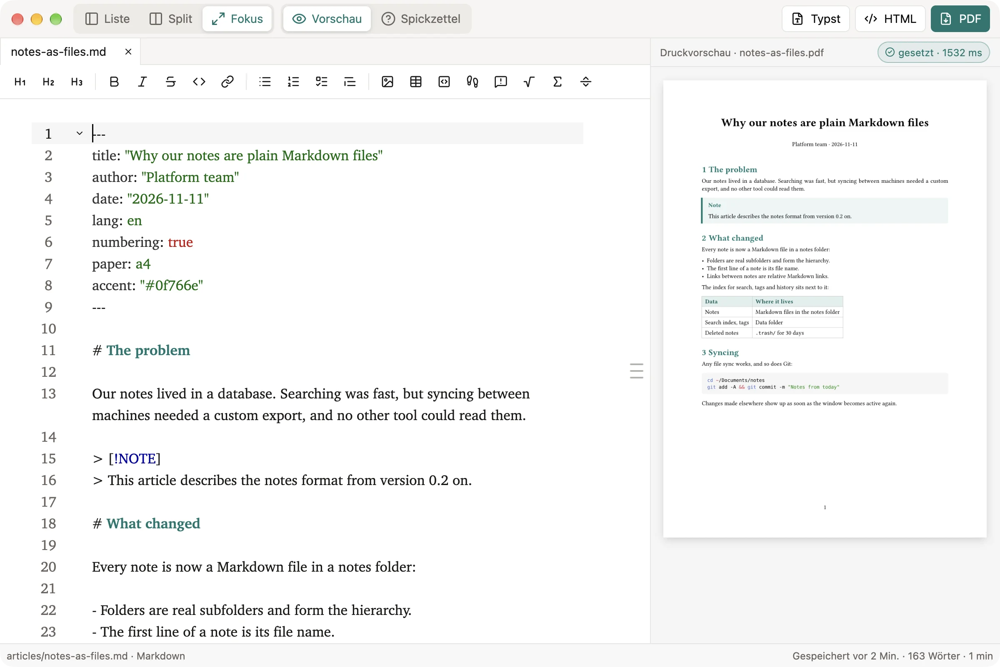

# DevMark

A desktop editor for code, notes and long-form writing, built with Rust and [GPUI](https://www.gpui.rs). Markdown and Typst with a live print preview and PDF export, notes as plain Markdown files. Local-first, for macOS, Windows and Linux.



**Documentation:** [casoon.github.io/devmark](https://casoon.github.io/devmark/)

## Features

- **Editor:** a workspace folder with file tree, syntax highlighting, tabs and split view.
- **Writing:** Markdown and Typst with formatting bar, insert list and templates; live print preview with build status and PDF export, all offline.
- **HTML export:** a document or the whole notes folder as static pages, one `.html` file each plus a stylesheet, without JavaScript; links between notes stay working.
- **Notes:** plain Markdown files in a notes folder, with full-text search, tags, links, favorites, history and trash.
- **Sync:** keep the notes folder in iCloud Drive, Nextcloud, Dropbox or Syncthing, or as a Git repository.

The interface is in German for now.

## Download

Prebuilt versions for macOS (Apple silicon and Intel) and Linux (x86_64) are attached to the [GitHub releases](https://github.com/casoon/devmark/releases). The macOS app is not notarized by Apple; on first start, open it with right-click → Open.

Official binaries come only from the GitHub releases of `casoon/devmark` — built there by the release workflow, never on a developer machine. To verify a download by hand, check the hash and the signed build provenance:

```bash
shasum -a 256 -c DevMark-<version>-macos-universal.zip.sha256
gh attestation verify DevMark-<version>-macos-universal.zip --repo casoon/devmark
```

Each download contains the licences of the third-party software it includes (`THIRD-PARTY-LICENSES.txt`).

## Build and run

```sh
cargo run -p devmark -- <folder-or-file>
```

On macOS, `scripts/bundle-macos.sh --install` builds `DevMark.app` and copies it to `/Applications`. Details: [Installation](https://casoon.github.io/devmark/docs/getting-started/installation/).

## License

Licensed under either of [Apache-2.0](LICENSE-APACHE) or [MIT](LICENSE-MIT), at your option.
